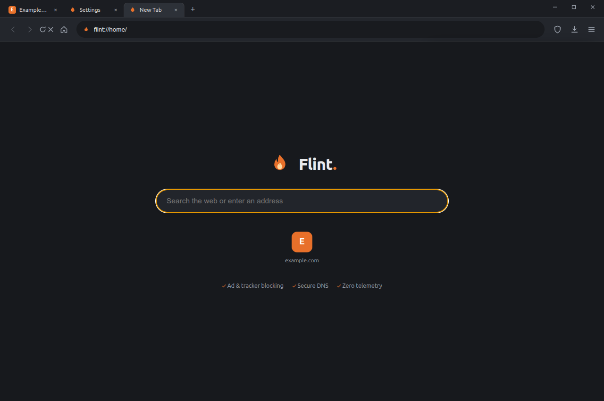
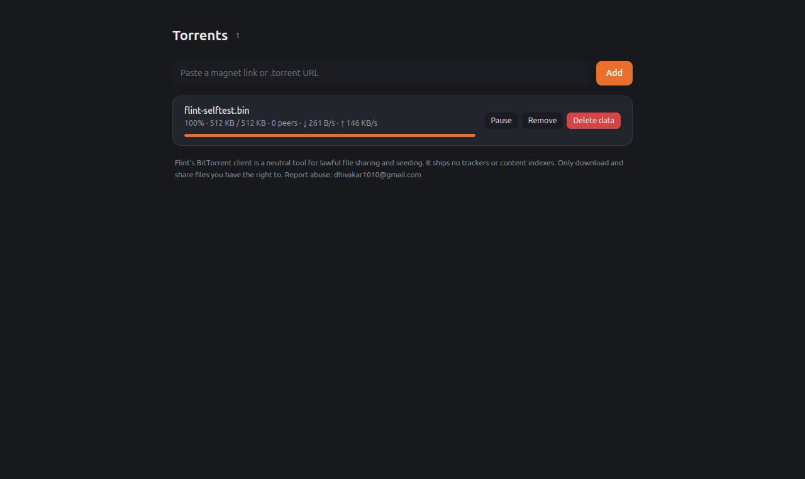
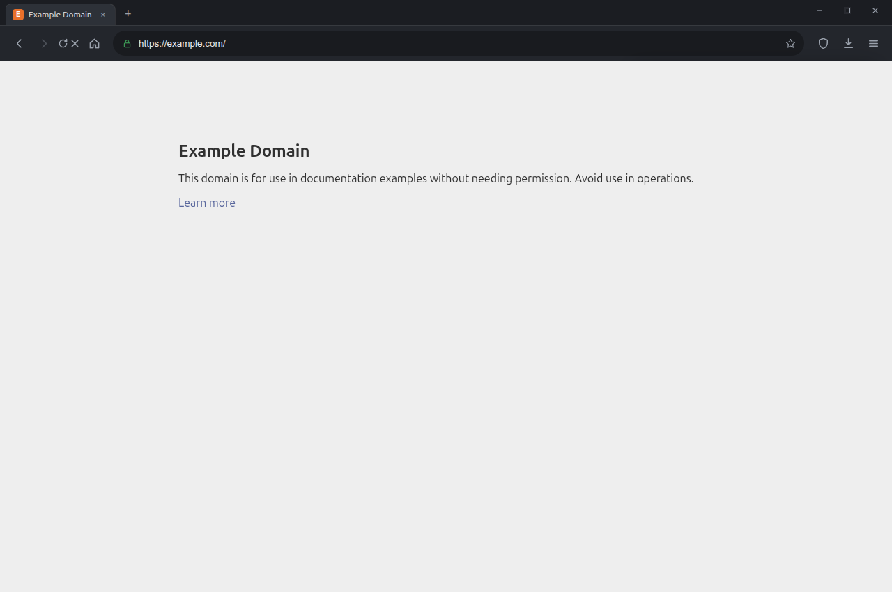
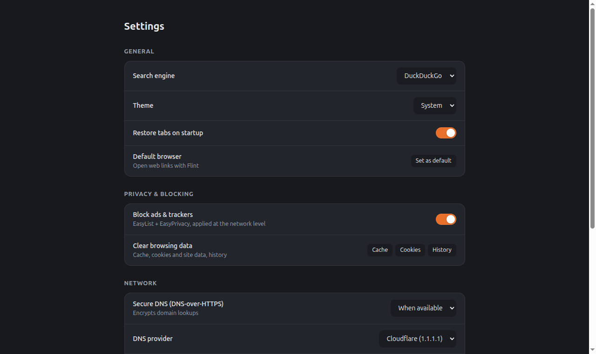

<p align="center">
  
</p>

<h1 align="center">Flint Browser</h1>

<p align="center">
  <b>Fast, private, batteries included.</b><br>
  A desktop web browser by <a href="https://github.com/Dhiva-Labs">Dhiva Labs</a> with ad &amp; tracker blocking,
  secure DNS, turbo downloads and reader mode built in — and zero telemetry.
</p>

<div align="center">

[](https://github.com/Dhiva-Labs/FlintBrowser/actions/workflows/build-installers.yml)


</div>



## Two editions

Flint is built from one codebase in two editions:

| | **Flint** (standard) | **Flint Plus** |
|---|---|---|
| Ad & tracker blocking, DoH, turbo downloads, reader mode, private windows | ✅ | ✅ |
| BitTorrent client | — | ✅ |
| Media grabber (direct downloads) | — | ✅ |
| Distribution | Store-safe — PPA, stores, anywhere | GitHub / PPA (direct) |

**Flint** is the clean, release-anywhere build: the standard package physically ships
without the BitTorrent library or grabber code, not merely a disabled version.
**Flint Plus** adds a BitTorrent client and a media downloader for power users.

The media grabber only detects *direct, unencrypted* media a page already served
(the way a download manager does). It never defeats DRM — DASH/EME streams are
ignored and protected streaming services are blocklisted outright. The BitTorrent
client ships no trackers, indexes or content; it is a neutral tool for lawful
file sharing.



## Features

- **Built-in ad & tracker blocking** — EasyList + EasyPrivacy applied at the network level (not an extension), with a per-site toggle and live blocked counters on every tab.
- **Secure DNS (DNS-over-HTTPS)** — one click to encrypt your DNS lookups via Cloudflare, Quad9, Google, AdGuard or your own resolver.
- **Turbo downloads ⚡** — Flint's own multi-connection segmented downloader with pause/resume, right in the download manager (right-click any link → *Turbo Download Link*).
- **Reader mode** — distraction-free article view (Ctrl+Alt+R) with font and sepia/dark controls.
- **Private windows** — fully ephemeral sessions (Ctrl+Shift+N), with blocking still active.
- **HTTPS-first** — typed addresses try HTTPS before HTTP; strict HTTPS-only mode available.
- **Everything a browser needs** — tabs with reopen-closed, omnibox with history/bookmark suggestions, bookmarks, history, downloads, find-in-page, zoom, print, session restore, custom search engine (DuckDuckGo default).
- **Zero telemetry** — Flint sends nothing, anywhere. No analytics, no crash uploads, no phone-home.

| Browsing | Settings |
|---|---|
|  |  |

## Install

### Ubuntu / Debian (PPA)

```bash
sudo add-apt-repository ppa:dhiva-labs/apps
sudo apt update
sudo apt install flint-browser
```

The PPA is built for amd64 only. On an arm64 machine use the `.deb` or
`.AppImage` from Releases (below).

### Direct download

Grab the latest build for your CPU from
[Releases](https://github.com/Dhiva-Labs/FlintBrowser/releases) — `flint-browser-*`
for the standard edition, `flint-browser-plus-*` for Flint Plus. Each release
carries x64 and arm64 builds:

| | x64 (Intel / AMD) | arm64 (aarch64, Windows on Arm) |
|---|---|---|
| Debian / Ubuntu package | `flint-browser-<version>-amd64.deb` | `flint-browser-<version>-arm64.deb` |
| AppImage | `flint-browser-<version>-x86_64.AppImage` | `flint-browser-<version>-arm64.AppImage` |
| Linux tarball | `flint-browser-<version>-x64.tar.gz` | `flint-browser-<version>-arm64.tar.gz` |
| Windows installer | `flint-browser-<version>-x64.exe` | `flint-browser-<version>-arm64.exe` |

Check which one you need with `uname -m` on Linux (`x86_64` is x64, `aarch64` is
arm64) or Settings, System, About on Windows ("System type").

```bash
# x64
sudo apt install ./flint-browser-1.0.1-amd64.deb
# arm64
sudo apt install ./flint-browser-1.0.1-arm64.deb
```

The AppImage needs no installation: `chmod +x` and run. The two editions install
side by side (distinct app IDs and executables). On Windows, run the installer
for your CPU; the arm64 build runs natively on Windows on Arm and the x64 build
also works there, through Windows' emulation, but slower.

## Build from source

```bash
git clone https://github.com/Dhiva-Labs/FlintBrowser.git
cd FlintBrowser
npm install
npm run build:engine   # compile the adblock engine from EasyList/EasyPrivacy
npm run build:icons
npm start              # runs the Plus edition in dev; use npm run start:standard for standard
```

Tests: `npm test` (unit) and `npm run smoke` (full in-app smoke suite — real
navigation, adblock, segmented download, media-grabber sniff and a live
BitTorrent transfer over a loopback tracker). `npm run smoke:standard` verifies
the standard edition ships without the Plus features.

Release artifacts: `npm run dist` builds both editions into `dist/`
(`npm run dist:standard` / `npm run dist:plus` for one). The packages are built
for the machine you run it on, so an arm64 machine produces arm64 packages; the
"Build installers" workflow does exactly that on native x64 and arm64 runners
for Linux and Windows.

## Architecture

Flint is an Electron app: every tab is an isolated, sandboxed Chromium
`WebContentsView`; the UI chrome is its own view stacked above them. Blocking
happens in the network layer via the Ghostery filters engine with a prebuilt
binary engine snapshot, so it works offline from first launch. Internal pages
live on the privileged `flint://` scheme (`flint://settings`,
`flint://downloads`, `flint://history`, `flint://bookmarks`, `flint://about`).

## Privacy

Flint has **no server side**. Your history, bookmarks and settings stay in
Flint's user-data folder on your device. Besides the pages and downloads you
ask for, the one connection Flint makes on its own is secure DNS: by default
lookups go to Cloudflare's DNS-over-HTTPS resolver (you can pick another
provider or turn it off in Settings). See [PRIVACY.md](PRIVACY.md) for the full
policy.

## Roadmap

- Cosmetic filtering (hiding ad placeholders)
- Bookmarks bar and folders
- Windows build
- Android companion (separate codebase)

## Sponsors

Dhiva Labs is an independent, self-funded lab. [Sponsorships](https://github.com/sponsors/Dhiva-Labs) help bring this project and the rest of Dhiva Labs to every platform, iPhone and Mac included.

[](https://github.com/sponsors/Dhiva-Labs)

Monthly sponsors at $10 and up are listed here:

<!-- sponsors -->
*Be the first: [sponsor Dhiva Labs](https://github.com/sponsors/Dhiva-Labs).*
<!-- sponsors -->

## License

[MIT](LICENSE) © Dhiva Labs · See [THIRD_PARTY_NOTICES](THIRD_PARTY_NOTICES.md)
for bundled open-source components.
